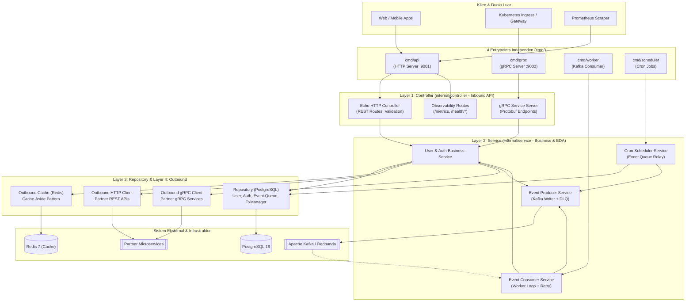
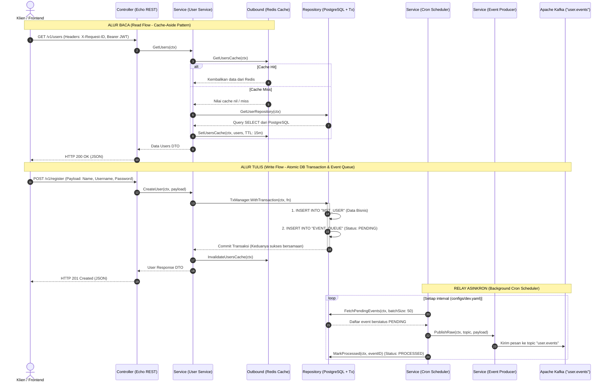
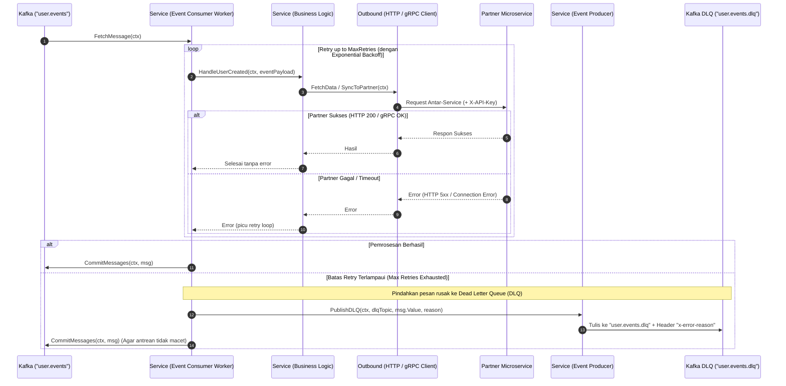
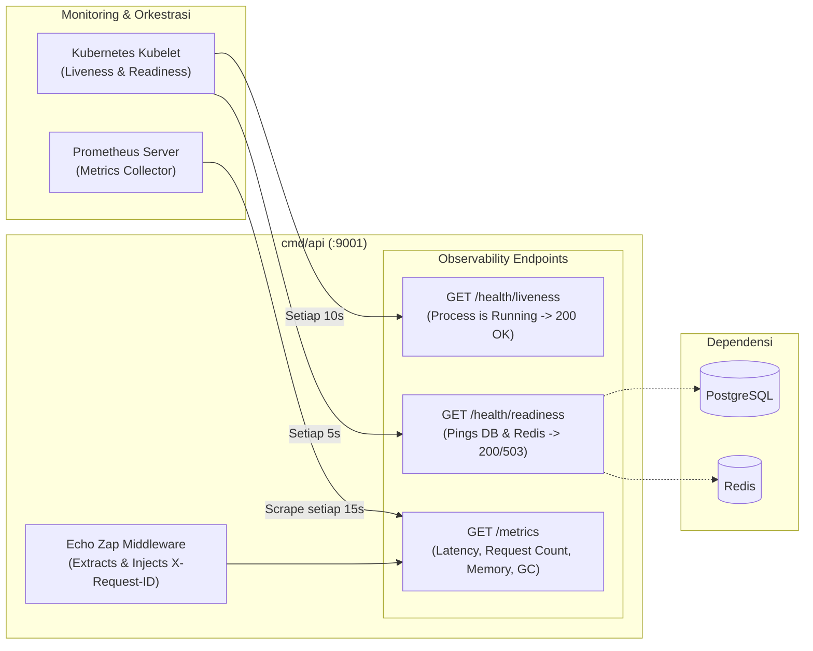

# Go Enterprise Microservice Boilerplate

Standar *boilerplate* microservice Go kelas industri berbasis **Clean Architecture & Event-Driven Architecture (EDA)** sesuai standar arsitektur microservice Blibli. Didesain untuk performa tinggi, skalabilitas independen di Kubernetes, keandalan pengiriman pesan (*guaranteed at-least-once delivery*), dan isolasi tanggung jawab yang ketat (*Strict Layer Boundaries*).

Teknologi utama yang digunakan:
- **Framework API**: [Echo v4](https://echo.labstack.com/) (REST HTTP) & [gRPC](https://grpc.io/)
- **Messaging & EDA**: [Apache Kafka (`segmentio/kafka-go`)](https://github.com/segmentio/kafka-go) dengan Transactional Event Queue & Dead Letter Queue (DLQ)
- **Database & Cache**: [GORM (PostgreSQL)](https://gorm.io/) & [Go-Redis v9](https://github.com/redis/go-redis) (Cache-Aside Pattern)
- **Job Scheduler**: [Cron v3 (`robfig/cron/v3`)](https://github.com/robfig/cron) (Jadwal deklaratif via YAML)
- **Dependency Injection**: [Uber Dig](https://github.com/uber-go/dig)
- **Structured Logging & Tracing**: [Uber Zap](https://github.com/uber-go/zap) dengan `X-Request-ID` Context Flow
- **Observability**: Prometheus Metrics (`/metrics`) & Kubernetes Probes (`/health/liveness`, `/health/readiness`)

Seluruh struktur direktori dan penamaan layer di dalam template ini bersifat **baku (standardized)** sehingga dapat langsung diduplikasi ke repository microservice baru tanpa membuang atau mengubah hirarki folder.

---

## 1. Aturan Baku 4-Tier Layer (Strict Layer Boundaries)

Microservice ini membagi kode ke dalam 4 layer utama di dalam folder `internal/` yang saling terisolasi:

```text
               ┌────────────────────────────────────────────────────────┐
               │              LAYER 1: CONTROLLER (INBOUND)            │
               │   • internal/controller/http (Echo REST API)          │
               │   • internal/controller/grpc (gRPC Service Server)    │
               └───────────────────────────┬────────────────────────────┘
                                           │ memanggil
                                           ▼
               ┌────────────────────────────────────────────────────────┐
               │              LAYER 2: SERVICE (CORE DOMAIN)           │
               │   • internal/service/<domain> (Logika Bisnis)         │
               │   • internal/service/event/producer (Kirim Kafka/DLQ) │
               │   • internal/service/event/consumer (Terima Kafka)    │
               │   • internal/service/scheduler (Cron Jobs)            │
               └───────────────────────────┬────────────────────────────┘
                                           │
                        ┌──────────────────┴──────────────────┐
                        ▼                                     ▼
        ┌───────────────────────────────┐     ┌───────────────────────────────┐
        │  LAYER 3: REPOSITORY (DB)     │     │  LAYER 4: OUTBOUND (EXTERNAL) │
        │  • internal/repository/<dom>  │     │  • internal/outbound/cache    │
        │  • internal/repository/tx     │     │  • internal/outbound/http     │
        │  • internal/repository/queue  │     │  • internal/outbound/grpc     │
        └───────────────┬───────────────┘     └───────────────┬───────────────┘
                        ▼                                     ▼
                  [PostgreSQL]                       [Redis / External API]
```

### Ringkasan Tanggung Jawab & Larangan per Layer

| Layer (`internal/`) | Tanggung Jawab Utama | Aturan Ketat (Strict Boundary Rules) |
| :--- | :--- | :--- |
| **`controller`** | **Murni Inbound API** (HTTP REST & gRPC Server). Menerima request eksternal, validasi input DTO, dan meneruskan ke `service`. | ❌ **Dilarang** menaruh Kafka Consumer, Cron Scheduler, atau query Database di dalam `controller`. |
| **`service`** | **Pusat Logika Bisnis, EDA Event, & Scheduler**. Mengorkestrasi aturan bisnis, memanggil `repository` untuk data, `outbound` untuk cache/API eksternal, dan mengelola penerimaan/pengiriman event Kafka. | 💡 Satu-satunya layer yang boleh mengoordinasikan `repository` dan `outbound`. |
| **`repository`** | **Murni Akses Database (PostgreSQL)**. Berisi query GORM, `transaction.Manager` (`WithTransaction`), dan tabel antrean event (`event_queue`). | ❌ **Dilarang** memanggil Redis, Kafka, atau HTTP/gRPC Client di dalam `repository`. |
| **`outbound`** | **Murni Integrasi Keluar & Caching**. Berisi Redis Cache (`outbound/cache`), Cross-Service REST Client (`outbound/http`), dan Cross-Service gRPC Client (`outbound/grpc`). | 💡 Setara levelnya dengan `repository`, hanya boleh dipanggil oleh `service`. |

---

## 2. Diagram Cara Kerja Template

### Diagram 1: Arsitektur 4 Entrypoint & Alur Komponen (Flowchart)

Aplikasi memiliki 4 entrypoint independen di `cmd/` yang dapat dijalankan sebagai pod/container terpisah di Kubernetes:



---

### Diagram 2: Sequence Diagram — Inbound API, Cache-Aside & Transactional Event Queue

Diagram ini mengilustrasikan bagaimana request baca (Read) dan tulis (Write) diproses secara atomik tanpa risiko *dual-write failure*:



---

### Diagram 3: Sequence Diagram — Kafka Event Consumer (Retry & Dead Letter Queue - DLQ)

Diagram ini mengilustrasikan worker penerima event yang dilengkapi dengan mekanisme *retry backoff* dan penerusan otomatis ke DLQ jika batas kegagalan terlampaui:



---

### Diagram 4: Observability, Health Checks & Tracing Flow



---

## 3. Struktur Direktori Proyek

```text
go-template/
├── .air.toml                    # Konfigurasi Live Hot-Reload untuk development lokal
├── .github/workflows/           # CI/CD GitHub Actions (Test, Coverage, Build Check)
├── .golangci.yml                # Konfigurasi linter Go berstandar industri
├── .mockery.yaml                # Konfigurasi generator mock otomatis (mockery)
├── cmd/                         # 4 Binary Entrypoint Independen
│   ├── api/main.go              # 1. HTTP REST API Server (:9001)
│   ├── grpc/main.go             # 2. Standalone gRPC Server (:9002)
│   ├── worker/main.go           # 3. Kafka Event Consumer Worker
│   └── scheduler/main.go        # 4. Cron Job Scheduler (jadwal via configs/*.yaml)
├── configs/                     # File Konfigurasi Deklaratif (dev.yaml, prod.yaml)
├── deployments/                 # Dockerfile (Multi-stage) & docker-compose.yml
├── docs/                        # Dokumentasi API (OpenAPI 3.0 & Swagger UI di /swagger)
├── internal/                    # Layer Internal Aplikasi (Private)
│   ├── controller/              # [LAYER 1] Inbound Controller (HTTP & gRPC)
│   │   ├── http/                # Routes Echo, Handler Auth & User
│   │   ├── grpc/                # gRPC Server Handler & Interceptor
│   │   └── model/               # Request & Response DTOs
│   ├── service/                 # [LAYER 2] Core Business Logic, EDA & Cron
│   │   ├── auth/                # Business logic registrasi & autentikasi
│   │   ├── user/                # Business logic pengelolaan user
│   │   ├── event/               # Producer & Consumer Kafka (Retry + DLQ)
│   │   └── scheduler/           # Cron runner untuk Event Queue relay
│   ├── repository/              # [LAYER 3] Akses Database PostgreSQL Murni
│   │   ├── transaction/         # GORM Transaction Manager (WithTransaction)
│   │   ├── model/               # GORM Database Entities
│   │   ├── auth/                # Repository Auth DB
│   │   ├── user/                # Repository User DB
│   │   └── event_queue/         # Repository Tabel EVENT_QUEUE (Transactional Outbox)
│   ├── outbound/                # [LAYER 4] Integrasi Eksternal & Caching
│   │   ├── cache/               # Outbound Redis (Cache-Aside Pattern)
│   │   ├── http/                # Outbound REST Client ke service lain
│   │   └── grpc/                # Outbound gRPC Client ke service lain
│   └── middleware/              # Zap Logger, JWT Auth, API Key, Prometheus
├── migrations/                  # File DDL SQL PostgreSQL murni
├── pkg/                         # Pustaka & Resource Bersama (Shared Resources)
│   ├── config/                  # Parser konfigurasi YAML & Env
│   ├── di/                      # Container Dependency Injection (Uber Dig)
│   ├── event/                   # Format Envelope CloudEvents JSON
│   ├── hash/                    # Helper Bcrypt password hashing
│   ├── logger/                  # Uber Zap Logger dengan Context Tracing
│   ├── resource/                # Resource Pool: PostgreSQL, Redis, Kafka, HTTP/gRPC Client
│   ├── response/                # Standar Response JSON API
│   └── validator/               # Struct validator payload HTTP
├── proto/                       # Kontrak Protocol Buffers (.proto) & Generated Go code
├── Makefile                     # Perintah otomatisasi build, run, test, dan linter
└── README.md                    # Dokumentasi utama proyek
```

---

## 4. Panduan Menjalankan Aplikasi

### Persiapan Awal
Salin environment template dan unduh seluruh dependency Go:

```bash
cp .env.example .env
make tidy
```

### Opsi A: Menjalankan Seluruh Stack via Docker Compose
Menjalankan PostgreSQL, Redis, Kafka (Redpanda), Kafka-UI (`:8080`), HTTP API (`:9001`), gRPC (`:9002`), Worker, dan Scheduler sekaligus:

```bash
make docker-up
```
Untuk menghentikan:

```bash
make docker-down
```

### Opsi B: Menjalankan Secara Independen di Lokal

| Perintah | Deskripsi | URL / Port |
| :--- | :--- | :--- |
| `make dev` | Menjalankan HTTP API dengan **Live Hot-Reload** (Air) | `http://localhost:9001` |
| `make run` | Menjalankan HTTP REST API biasa | `http://localhost:9001` |
| `make run-grpc` | Menjalankan server gRPC standalone | `localhost:9002` |
| `make run-worker` | Menjalankan Kafka Event Consumer Worker | Background CLI |
| `make run-scheduler`| Menjalankan Cron Scheduler Job | Background CLI |

---

## 5. Testing, Code Quality & Build

### Unit Testing & Coverage Report
Seluruh unit test diletakkan berdampingan dengan filenya (*colocated unit test*) dengan pengujian mock di setiap layer:
```bash
make test           # Menjalankan seluruh unit test
make test-coverage  # Menjalankan unit test & membuat visual report coverage.html (Coverage: 84.3%)
```
Buka file `coverage.html` di browser untuk melihat baris kode mana saja yang telah terlindungi test.

### Static Code Analysis (Linter)
Memeriksa kualitas kode Go, unhandled errors, dan potensi *memory leaks*:
```bash
make lint
```
### Build Binary Produksi
Meng-compile keempat microservice menjadi file binary mandiri di dalam folder `./bin/`:
```bash
make build-all
```
File yang dihasilkan:
- `./bin/api` (HTTP REST API Server)
- `./bin/grpc` (gRPC Server)
- `./bin/worker` (Kafka Consumer Worker)
- `./bin/scheduler` (Cron Job Scheduler)

---

## 6. Observability, Metrik & Health Probes

Microservice ini sudah terintegrasi dengan standar monitoring modern:

1. **Prometheus Metrics**:
   - `GET http://localhost:9001/metrics`
   - Mengekspos histogram latensi request HTTP, status code counter, jumlah goroutine, thread, dan alokasi memori GC.
2. **Kubernetes Liveness Probe**:
   - `GET http://localhost:9001/health/liveness`
   - Mengembalikan HTTP `200 OK` selama proses aplikasi berjalan. Digunakan K8s untuk me-restart pod jika terjadi deadlock.
3. **Kubernetes Readiness Probe**:
   - `GET http://localhost:9001/health/readiness`
   - Melakukan live-ping serentak ke PostgreSQL dan Redis. Mengembalikan HTTP `200 OK` jika semua siap, atau HTTP `503 Service Unavailable` jika ada dependensi yang bermasalah.
4. **Distributed Tracing Header (`X-Request-ID`)**:
   - Setiap request HTTP secara otomatis diekstrak header `X-Request-ID`-nya (atau dibuatkan UUID baru jika belum ada).
   - ID tersebut disuntikkan ke dalam `context.Context` dan dicatat pada setiap baris log Uber Zap melalui helper `logger.FromContext(ctx, log)`.
5. **Interactive Swagger UI**:
   - Buka `http://localhost:9001/swagger` untuk menguji API secara langsung dari browser.

---

## 7. Glosarium Penamaan Baku

| Istilah Baku | Arti / Konsep Asal | Mengapa Dinamakan Demikian? |
| :--- | :--- | :--- |
| **`repository/transaction`** | Database Transaction (`BEGIN`, `COMMIT`, `ROLLBACK`) | Menggantikan singkatan teknis `tx`. Menandakan fungsi wrapper `WithTransaction` untuk menjamin konsistensi ACID beberapa query. |
| **`repository/event_queue`** | Transactional Outbox Pattern | Menggantikan istilah teknis `outbox`. Menegaskan bahwa ini adalah tabel antrean event (`EVENT_QUEUE`) di database yang menunggu dikirimkan ke Kafka oleh scheduler. |
| **`service/scheduler/event_queue`** | Outbox Relay Job | Job cron yang bertugas membaca baris `PENDING` di `EVENT_QUEUE` lalu meneruskannya ke Kafka topic. |
| **`service/event/producer`** | Message Producer | Modul pengirim pesan ke broker Kafka (+ pengiriman ke topic DLQ). |
| **`service/event/consumer`** | Message Consumer Worker | Modul penerima pesan dari broker Kafka dengan logika retry & dead letter queue. |
| **`outbound/*`** | Outbound Adapter (Hexagonal Architecture) | Mengelompokkan semua integrasi ke luar sistem (Redis Cache, REST HTTP Client ke partner, gRPC Client ke partner). Berada di level layer yang setara dengan `repository`. |
